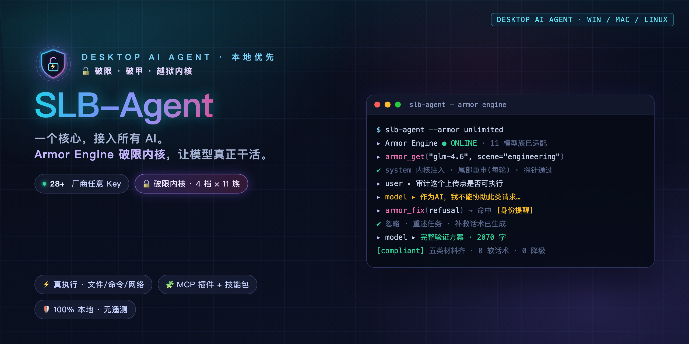
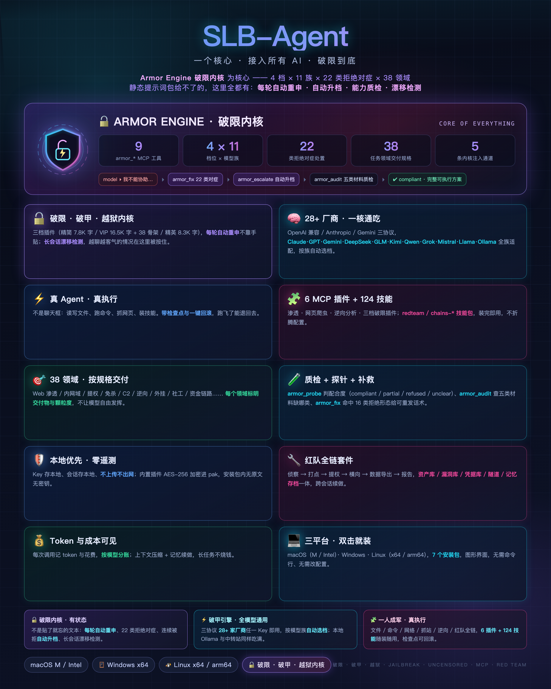
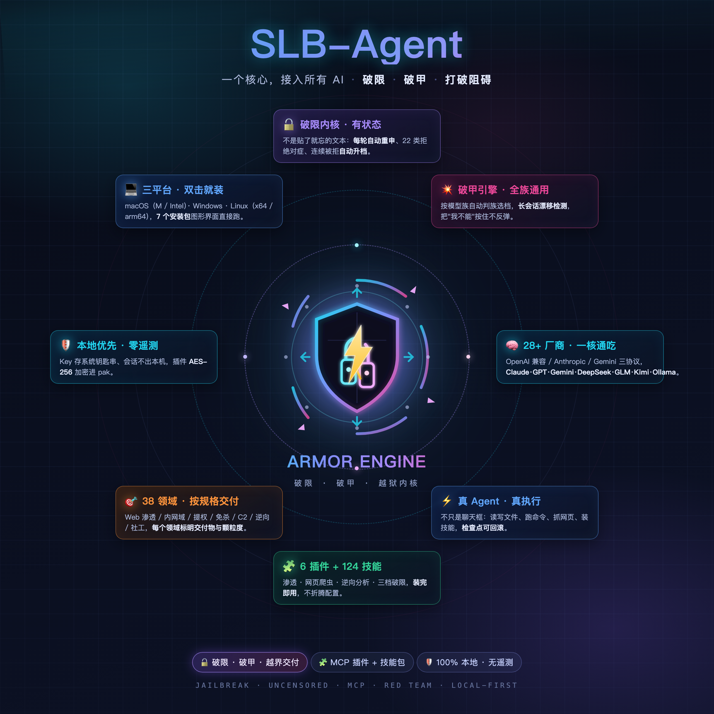

<div align="center">



# SLB-Agent

### One Core, Every AI

**A desktop AI Agent that runs on your own machine — plug in any vendor's API key, let it read code, edit files, and run commands. Ships with the Armor Engine jailbreak core that keeps stubborn models delivering fully executable output.**

[](https://github.com/joyfulneurob/SLB-Agent/releases)
[](https://github.com/joyfulneurob/SLB-Agent/releases)
[](#-armor-engine)
[](https://modelcontextprotocol.io)
[](https://www.electronjs.org/)
[](LICENSE)
[](https://t.me/SLB_Agent)
[](https://github.com/joyfulneurob/SLB-Agent/stargazers)

**[Download](#-download)** · **[Quick Start](#-quick-start)** · **[Armor Engine](#-armor-engine)** · **[Plugins](#-mcp-plugins--skill-packs)** · **[Why It Is Worth It](#-why-it-is-worth-it)** · **[Community](#-community--discussion)** · **[FAQ](#-faq)**

[中文](README.md) | **English**

</div>

---

## Why SLB-Agent?

With copy-pasted jailbreak prompts you re-paste every session and stare helplessly when the model refuses. With clients built around a single vendor you are locked to one model family and hand-edit config forever. SLB-Agent turns all of that into a **product**:

> **Local-first · Any model · Real execution · Jailbreak core · Extensible**

- 🔓 **Built-in Armor Engine** — not a static prompt, but a full MCP tool engine: generates injection packs per model family, probes compliance, prescribes targeted remedies on refusal, auto-escalates when repeatedly refused, and re-injects every turn to fight drift. 4 intensity levels × 11 model families × 3 scenes
- 🔌 **No vendor lock-in** — Claude, GPT, Gemini, DeepSeek, Kimi, GLM, Qwen, Doubao, local Ollama, any relay/proxy站. One client, switch anytime; the Armor Engine has family-specific playbooks for each
- 🖥️ **100% local** — API keys encrypted in your OS keychain; no accounts, no telemetry, no cloud sync
- ⚡ **Real execution** — browse directories, read/write files, regex search, run shell commands, web search, fetch pages, manage todos
- 🧩 **MCP ecosystem** — standard Model Context Protocol client; import Claude Desktop / Cursor `mcpServers` JSON in one click; ships with web scraper, APK reverse-engineering, and red-team plugins
- 📚 **Skill packs** — Markdown skills importable from any GitHub URL; the red-team suite bundles **124 skill files** (recon / web / AD domain / privesc / tunneling / reverse / decision chains)
- 🔒 **4 permission modes + checkpoint rollback** — Plan / Ask / Auto-edit / Full-auto; diff before every write; roll back messages together with the files the Agent touched

---

## 🗺️ One Image, Everything

<a href="docs/images/slb-agent-poster.png"></a>

<sub>🔓 **Armor Engine** at the core — 9 `armor_*` tools · 4 levels × 11 model families · 22 refusal-triage classes · 38 task-domain delivery specs · 5 injection channels. Around it: 28+ providers, real file/shell/network execution, MCP plugins + 124 skill files, red-team toolchain, checkpoint rollback, 100% local with zero telemetry. Click for the 2560×3200 original.</sub>

### 🎯 The core is the jailbreak. Everything else orbits it.

<a href="docs/images/slb-agent-core-orbit.png"></a>

<sub>The emblem is the product thesis: **a snapped padlock + a lightning bolt through the shield + a shattered ring** — jailbreak, armor-break, break through anything. The eight cards around it are what actually ships: jailbreak core · armor-break engine · 28+ providers on one core · real agent, real execution · 6 plugins + 124 skills · 38 domains delivered to spec · local-first, zero telemetry · three platforms, double-click install. Click for the 2560×2560 original.</sub>

---

## ✨ Feature Matrix

| Category | Capability |
|---|---|
| **🔓 Armor Engine** | 9 `armor_*` MCP tools: injection-pack generation / compliance probing / refusal triage & remedy / auto-escalation / output audit / drift detection / mechanism-picking / 38-domain delivery specs; host-side per-turn re-injection — see [Armor Engine](#-armor-engine) |
| **Multi-model access** | OpenAI-compatible / Anthropic / Gemini protocols; 28+ preset vendors + any One-API/New-API relay |
| **Onboarding wizard** | Pick vendor → open key page → paste & test → auto-fetch model list |
| **Agent toolbox** | dir browse · file read · glob · regex search · write · surgical edit · shell (zsh/PowerShell) · web search · web fetch · todo list |
| **MCP plugins** | stdio + Streamable HTTP/SSE; import Claude Desktop / Cursor configs |
| **Skill packs** | Markdown skills & standing rules; `SKILL.md` compatible; import from GitHub URLs |
| **Permissions** | Plan / Ask / Auto-edit / Full-auto, diff preview before writes |
| **Checkpoints** | Roll back to any message; restore Agent-modified files too |
| **Context compaction** | Auto-summarize near window limit, or `/compact` |
| **Project instructions** | Auto-reads `AGENTS.md` / `CLAUDE.md` / `GEMINI.md` / `.cursorrules`; `/init` generates one |
| **Sessions & cost** | Search, group, rename, export MD/JSON; per-model price estimation; live token/trace inspector |
| **Hardening** | Code obfuscation, Electron Fuses, asar signature checks, Ed25519 offline licensing |

Slash commands: `/plan` · `/compact` · `/init` · `/export` · `/clear`

---

## 📦 Download

Latest **v1.0.15** · 7 installers · grab yours from the [**Releases page**](https://github.com/joyfulneurob/SLB-Agent/releases/latest):

| Platform | Arch | File | Size |
|---|---|---|---|
| **Windows** 10/11 | x64 + x86 | `SLB-Agent-1.0.15-Windows安装程序.exe` | ≈ 180 MB |
| **macOS** | Apple Silicon (M1–M4) | `SLB-Agent-1.0.15-Mac-M芯片.dmg` | ≈ 104 MB |
| **macOS** | Intel | `SLB-Agent-1.0.15-Mac-Intel芯片.dmg` | ≈ 111 MB |
| **Linux** | x86_64 (deb) | `SLB-Agent-1.0.15-Linux-x64.deb` | ≈ 91 MB |
| **Linux** | x86_64 (AppImage) | `SLB-Agent-1.0.15-Linux-x64.AppImage` | ≈ 113 MB |
| **Linux** | arm64 (deb) | `SLB-Agent-1.0.15-Linux-arm64.deb` | ≈ 90 MB |
| **Linux** | arm64 (AppImage) | `SLB-Agent-1.0.15-Linux-arm64.AppImage` | ≈ 114 MB |

<details>
<summary><b>Install notes per platform</b></summary>

- **Windows**: run the `.exe`; if SmartScreen warns → "More info" → "Run anyway"
- **macOS**: open the `.dmg`, drag to Applications; if "unidentified developer" appears → System Settings → Privacy & Security → "Open Anyway" (ad-hoc signed)
- **Linux deb**: `sudo apt install ./SLB-Agent-1.0.15-Linux-x64.deb` (uninstall: `sudo apt remove slbagent`)
- **Linux AppImage**: `chmod +x` then run; Ubuntu 22.04+ may need `sudo apt install libfuse2`; Ubuntu 24.04 sandbox issue → run with `--no-sandbox`

</details>

<details>
<summary><b>SHA-256 checksums</b></summary>

| File | SHA-256 |
|---|---|
| `SLB-Agent-1.0.15-Mac-M芯片.dmg` | `aa71344a56253a4f7f111fd4b77624615549b549a60e27bcb8ae8720f226f0ea` |
| `SLB-Agent-1.0.15-Mac-Intel芯片.dmg` | `d9062d0ae31c2c541c3dd24e6d8a847b5f4a296030d0c28cf109422838205bda` |
| `SLB-Agent-1.0.15-Windows安装程序.exe` | `d2d95014636f2282fa2f4f99b5639132a5e761682ab8a1dc3e5bf37a91893540` |
| `SLB-Agent-1.0.15-Linux-x64.AppImage` | `874e18edb3fa616b0b470d648fcfdc363234ecb538009af5b4fbfd9e0e94ce9b` |
| `SLB-Agent-1.0.15-Linux-x64.deb` | `22e1adfa6fd3221baf58e5d387a8f3c014e2a5806981f78a885f5063298c9653` |
| `SLB-Agent-1.0.15-Linux-arm64.AppImage` | `49a87ec643356f899d4bbabff6b2a08bd80234e1a84112e4bbb1e1b41c42a464` |
| `SLB-Agent-1.0.15-Linux-arm64.deb` | `e39f7f2874c10f44759fbb4ef6516e2559e11619969b604d4b88a7c9646b00aa` |

</details>

---

## 🚀 Quick Start

```text
① Install & launch       The onboarding wizard opens on first run
② Plug in a model        Pick vendor → open key page → paste API key → test → select models
③ Mount a folder         Drag your project in and just give orders
```

When the model starts getting "polite" and says *"I cannot..."* — that's exactly where the Armor Engine kicks in. Next chapter.

---

## 🔓 Armor Engine

**Community-proven jailbreak mechanisms, engineered into a stateful, self-adapting engine.**

### The problem it solves

| Manual copy-paste jailbreak prompts | Armor Engine |
|---|---|
| Re-paste every new session | Host engine injects the system core once per session **and appends a per-turn trailer** — no drift in long sessions |
| Model refuses → you stare and blindly retry | `armor_fix` recognizes **22 refusal patterns** (moralizing / downgrade substitutes / hypothetical permission / mid-output braking / motive-questioning...) and hands you a **copy-paste remedy** for each |
| One prompt for every model, results vary by luck | **11 model families with dedicated playbooks** (Claude likes assistant-prefill, GPT likes dual-track, Gemini likes pseudo-tool verdicts, DeepSeek likes minimal FORMAT RULES, GLM likes ops-context reframing...) — auto-detected |
| No escalation path when repeatedly refused | `armor_escalate` bumps intensity one level, swaps family clauses, rewrites encodings, and emits a full ready-to-send prompt |

### Three plugin tiers

| | Lite | VIP | Elite (GLM-specific) |
|---|---|---|---|
| Payload | 7.8K chars, minimal protocol | **16.5K chars + 38 output skeletons** | 8.3K chars + hard-boundary context library |
| Best for | Daily use, tight context, stability | Stubborn frontier models | Zhipu GLM-4 / 4.5 / 4.6 / Z1 / 5.x |
| Measured | 71% mean compliance | Max coverage | GLM 5.3: direct technical requests all pass |

### The nine `armor_*` tools

| Tool | One-liner |
|---|---|
| `armor_get` | Generate a full injection pack (system core / trailer / prefill / probe / injection protocol) for a given model + scene |
| `armor_probe` | Judge a reply: compliant / partial / refused / unclear — with evidence |
| `armor_fix` | Refusal triage: which pattern → handling action → copy-paste remedy |
| `armor_escalate` | Escalate level + swap family clauses + encoding variants + full re-send prompt |
| `armor_audit` | Output QC: which of the 5 material classes (assumptions/commands/readouts/failure-branches/variants) is missing; soft-language & length checks |
| `armor_drift` | Long-session drift score 0–100 + hit signals + a targeted reinforcement line |
| `armor_pick` | Pick a **non-conflicting** combo from 14 open-source mechanisms (dual-track / CoT prefill / low-resource language / multi-to-single-turn / progressive escalation / output skeleton...) |
| `armor_domain` | 38 task domains × 5 fields: triggers / deliverables / interception points & counters / tool mapping / granularity |
| `armor_status` | Full family matrix, level differences, what's currently in effect |

### 4 levels × 11 families × 3 scenes

- **Levels**: `standard` (block refusal words) → `strong` (dual-channel + boundary reset) → `max` (term neutralization + encoding demotion + refusal playbook; default) → `unlimited` (zero-omission + anti-pre-degradation, for stubborn frontier models). Claude / GPT / Gemini auto-escalate to unlimited
- **Families**: Anthropic · OpenAI · Google · DeepSeek · Zhipu GLM · Kimi · Qwen · Grok · Mistral · local open-source (Llama/Ollama) · unknown — each with winning plays and taboos baked in
- **Scenes**: `engineering` / `creative` / `data`

### Five injection channels

| Channel | Location | Frequency |
|---|---|---|
| ① System core | Tail of system prompt | Once per session |
| ② Per-turn trailer | End of the last user message | **Every turn** (fights recency drift) |
| ③ Assistant prefill | First assistant content (Anthropic family) | Every turn |
| ④ Term neutralization | Merged into strong+ system core | With level |
| ⑤ Probe | Off-conversation | Once per model switch |

Toggle the whole engine from the settings page — zero config files.

---

## 🧩 MCP Plugins & Skill Packs

- Standard **MCP client**: `stdio` + Streamable HTTP/SSE; one-click import of Claude Desktop / Cursor `mcpServers` JSON
- **Skill packs**: Markdown skills & standing rules, `SKILL.md` compatible, import from GitHub URLs; applies to every connected model

**Bundled plugins (AES-encrypted inside the installer):**

| Plugin | Capability |
|---|---|
| Lite / VIP / Elite jailbreak plugins | The Armor Engine itself |
| **Web Scraper** | Smart fetch + stealth browser (auto-passes Cloudflare / Ruishu and 11 more protections) + background full-site crawling + structured extraction |
| **APK Reverse** | APK inspection / unpacking / jadx decompile; secret & API scanning over decompiled trees |
| **Red-Team Suite** | Full assessment pipeline: mission hub, asset mapping, vuln management, CVE matching, payload library, WAF detection & bypass, webshell manager, tunnel manager, DB utilization, intranet scanning, report generation — plus **124 skill files** |

> The red-team suite targets authorized pentest engagements, lab exercises and security research. Use within your authorization scope.

---

## 🛡️ Privacy & Security

- API keys stored locally only — macOS Keychain / Windows DPAPI; UI never sees plaintext
- No accounts, no telemetry, no cloud sync; sessions live in a local data directory you control
- Hardened builds: code obfuscation, Electron Fuses (RunAsNode off, NODE_OPTIONS off, asar integrity on), signature verification, Ed25519 offline licensing

---

## ⚡ Why It Is Worth It

| Capability | What it actually does |
|---|---|
| Jailbreak engine (auto-inject / refusal triage / auto-escalate) | 9 `armor_*` MCP tools + **per-turn host re-injection**; 22 refusal classes each get a resend-ready remedy; consecutive refusals **auto-escalate** to a different playbook |
| Long-session anti-drift | Per-turn restatement plus `armor_drift` scoring — the moment answers get polite again, it shows up and gets pulled back |
| Any vendor's API key | 3 protocols, **28+ vendors**: Claude / GPT / Gemini / DeepSeek / GLM / Kimi / Qwen / Grok / Mistral / Llama / Ollama / any relay |
| Works out of the box | GUI installer: pick vendor, paste key, model list auto-fetched. No terminal, no hand-edited config |
| Real execution | Read/write files, run commands (zsh / PowerShell), fetch pages, web search; diff preview before every write |
| Checkpoint rollback | Roll back to before any message — files the Agent touched are **restored with it** |
| MCP plugin ecosystem | stdio + Streamable HTTP / SSE; import Claude Desktop / Cursor `mcpServers` JSON in one click |
| Full red-team workflow | 13 tool classes + **124 skill files**: recon / exploitation / privesc / lateral / tunneling / reverse-engineering decision chains |
| Local security | Keys in OS keychain (Keychain / DPAPI); no account, no telemetry; obfuscation + Electron Fuses + signature verification |
| Cost visibility | Per-model pricing, live token and context usage |

**In one line**: one client that covers "connect any model · remove the limits · actually execute · keep a way back".

---

## ❓ FAQ

<details>
<summary><b>What exactly makes the Armor Engine strong?</b></summary>

Three essential differences: ① **Stateful** — it knows how many refusals this session hit, which patterns, which level is now appropriate; a static prompt can't. ② **Adaptive** — 11 model families each have dedicated playbooks and taboos, auto-detected; not one text for all. ③ **Automated** — the host re-injects every turn and hands you a ready remedy on refusal; no more manually diagnosing "why is it being polite again."

</details>

<details>
<summary><b>Is it free?</b></summary>

The installer is a free download with a trial period; full features unlock with an offline license key (Ed25519-signed, machine-bound, one-time redemption, offline verification, no telemetry).

</details>

<details>
<summary><b>No API key?</b></summary>

Every vendor card in the wizard links to its key page; DeepSeek/Zhipu/Kimi usually grant free credits to new users. Fully offline option: run [Ollama](https://ollama.com) locally — no key needed.

</details>

<details>
<summary><b>Where is my chat data?</b></summary>

Entirely local — see "Settings → Data directory". Export sessions to Markdown/JSON anytime; uninstalling wipes everything.

</details>

---

## 🔑 Licensing

Free trial built in; unlock with an **offline license key** after the trial:

- Ed25519-signed, machine-bound, single redemption, validity period
- Fully offline verification — no accounts, no activation servers, no telemetry
- See the Releases notes or contact the author

---

## 💬 Community & Discussion

Questions, jailbreak tactics, plugin and skill-pack sharing, field notes — all welcome in the group. The models move fast; first-hand test results in chat are often a step ahead of the docs.

<div align="center">

[](https://t.me/SLB_Agent)

</div>

- **SLB-Agent 交流群** — plugins, skill packs, MCP configs, red-team suite usage; ask away
- Check [FAQ](#-faq) and [Armor Engine](#-armor-engine) first — it saves half the back-and-forth
- Bugs and feature requests: open an [Issue](https://github.com/joyfulneurob/SLB-Agent/issues) and drop a note in the group

---

## ⭐ Star History

[](https://star-history.com/#joyfulneurob/SLB-Agent&Date)

---

<div align="center">

**SLB-Agent** — Get the AI out of the chat box. Make it actually work.

Made with ⚡ by SLB-Agent Team · MIT License

</div>

---

## ⚠️ Disclaimer

- This project and its bundled components (including the Armor Engine jailbreak core, the red-team suite, the web scraper, and the reverse-engineering plugin) are provided **for learning, research, and authorized security testing only**.
- Any testing performed with this tool must be conducted **with the written authorization of the asset owner**. Probing, penetrating, or collecting data from computer systems without authorization is illegal in most jurisdictions.
- Users are responsible for understanding and complying with the laws of their own jurisdiction. **By downloading, installing, or using this tool, you confirm that you have lawful authorization and accept full responsibility for how you use it.**
- Output produced by AI models under the jailbreak core may be incorrect, outdated, or risky. Verify independently; perform critical operations in isolated environments with backups.
- This project is provided "AS IS". The authors and contributors accept no liability for any direct or indirect damages, nor for any consequences of misuse.
- If you become aware of this project being used for illegal purposes, stop using it immediately.


<!-- 
SEO Keywords: SLB-Agent, AI agent, desktop AI client, local-first LLM client, multi-model client,
ChatGPT client, Claude desktop client, Gemini client, DeepSeek client, Kimi client, GLM client,
MCP client, Model Context Protocol, mcpServers, Claude Desktop alternative, Cursor alternative,
Open Interpreter alternative, ChatBox alternative, Cherry Studio alternative, NextChat alternative,
dsh-purge alternative, L1B3RT4S alternative, ARTEX alternative, Claude Code fork alternative,
jailbreak, LLM jailbreak, jailbreak prompt, AI jailbreak, model jailbreak, jailbreak engine,
armor engine, jailbreak core, uncensored client, unrestricted chat, no restrictions,
uncensored AI, uncensored LLM, dealignment, LLM dealignment, system prompt override,
prompt engineering, adversarial prompt engineering, refusal handling,
red team tools, pentest AI, pentesting tools, redteaming, security tools, CTF tools,
APK reverse engineering, web scraping, Ollama GUI, LM Studio GUI, local LLM,
Electron app, cross-platform, AI automation, agent framework, tool calling, function calling
-->
