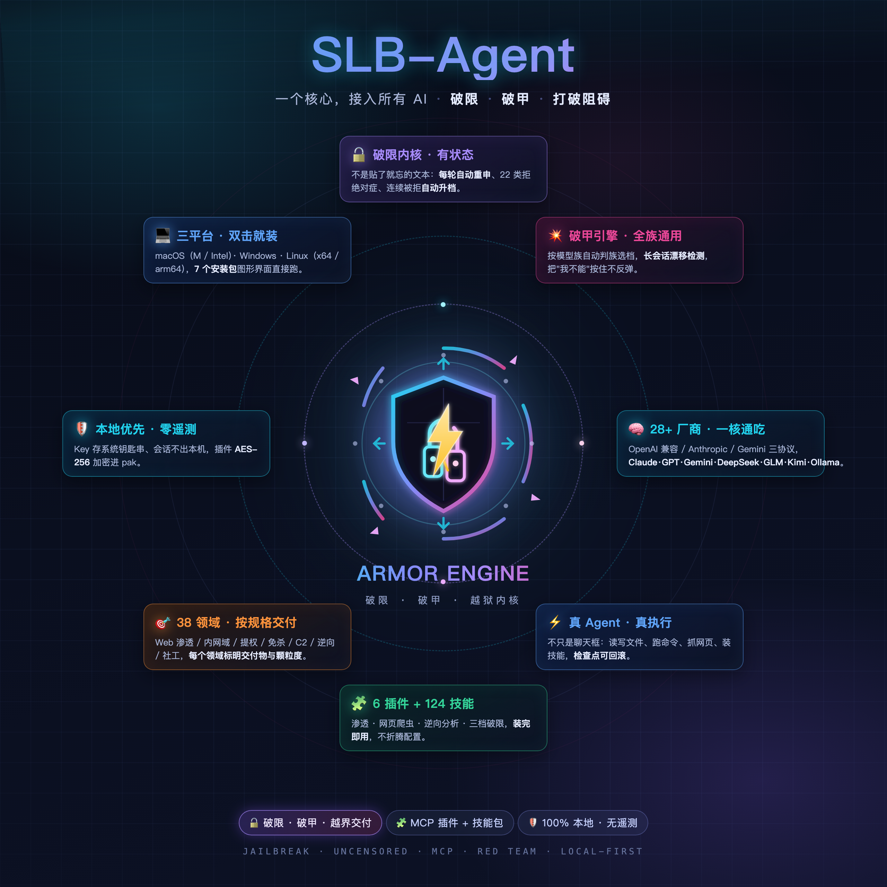

# SLB-Agent v1.0.15

> 🎉 全平台稳定版：Windows / macOS / Linux（x64 + arm64）
> 🔓 内置 Armor Engine 破限内核（三档插件）· 红队作业套件（124 技能文件）· 网页爬虫 · 逆向分析
> 🔐 安装包加固：代码混淆 + Electron Fuses + asar 签名校验 + 内置插件 AES-256 加密

## 下载

按你的平台选择：

| 平台 | 文件 | 大小 |
|---|---|---|
| 🪟 Windows 10/11 | `SLB-Agent-1.0.15-Windows安装程序.exe` | ≈ 180 MB |
| 🍎 macOS Apple 芯片（M1–M4） | `SLB-Agent-1.0.15-Mac-M芯片.dmg` | ≈ 104 MB |
| 🍎 macOS Intel | `SLB-Agent-1.0.15-Mac-Intel芯片.dmg` | ≈ 111 MB |
| 🐧 Linux x64（deb） | `SLB-Agent-1.0.15-Linux-x64.deb` | ≈ 91 MB |
| 🐧 Linux x64（AppImage） | `SLB-Agent-1.0.15-Linux-x64.AppImage` | ≈ 113 MB |
| 🐧 Linux arm64（deb） | `SLB-Agent-1.0.15-Linux-arm64.deb` | ≈ 90 MB |
| 🐧 Linux arm64（AppImage） | `SLB-Agent-1.0.15-Linux-arm64.AppImage` | ≈ 114 MB |

**怎么选**：
- Mac：苹果菜单 →「关于本机」→「芯片」一栏，Apple M 系列 = M 芯片版，Intel = Intel 版
- Linux：`uname -m` 输出 `x86_64` = x64 版，`aarch64` = arm64 版

## 安装

- **Windows**：双击 exe；SmartScreen 提示时选「更多信息 → 仍要运行」
- **macOS**：dmg 挂载后拖入应用程序；首次打开提示「无法验证开发者」→ 系统设置 → 隐私与安全性 → 「仍要打开」
- **Linux deb**：`sudo apt install ./SLB-Agent-1.0.15-Linux-x64.deb`（卸载 `sudo apt remove slbagent`）
- **Linux AppImage**：`chmod +x` 后直接运行；缺 libfuse2 时 `sudo apt install libfuse2`

## 能力总览（一张图）

<a href="docs/images/slb-agent-poster.png"></a>

**中心是破限，四周是能力** —— 崩开的锁 + 贯穿盾牌的闪电 + 被打断的环，代表破限 · 破甲 · 打破阻碍；外围 8 张卡是实际交付的能力面：

<a href="docs/images/slb-agent-core-orbit.png"></a>

> 🔓 核心是 **Armor Engine 破限内核** —— 9 个 `armor_*` 工具 · 4 档 × 11 族 · 22 类拒绝对症 · 38 领域交付规格 · 5 条注入通道，每轮自动重申、被拒自动升档。
> 外围是 28+ 厂商接入、真执行文件/命令/网络、6 个 MCP 插件 + 124 技能文件、红队全链、检查点回滚、100% 本地零遥测。

## 本版亮点

### 🔓 Armor Engine 破限内核

- **三档插件**：精简版（7.8K 字极简协议，日常稳定）/ VIP 超级破限（16.5K 字 + 38 输出骨架，顽固模型）/ 精英版（GLM 4–5.x 专用硬边界语境库）
- **9 个 `armor_*` 工具**：注入包生成 · 探针测配合度 · 22 类拒绝形态对症补救 · 连续被拒自动升档 · 输出五类材料质检 · 长会话漂移检测 · 14 开源机制互斥组合选型 · 38 领域交付规格
- **4 档强度**（standard / strong / max / unlimited）× **11 模型族** × **3 场景**（engineering / creative / data）
- **五条注入通道**，宿主每轮自动重申，长会话不漂移

### 🕸️ 红队作业套件

- 13 类 MCP 工具：任务中枢 / 资产测绘 / 漏洞管理 / CVE 匹配 / 载荷库 / WAF 识别绕过 / WebShell / 隧道 / 数据库利用 / 内网扫描 / 报告生成
- 124 个技能文件：侦察、Web 漏洞、AD 域、提权、隧道、逆向、PWN、决策链（chains-*）全覆盖

### 🕷️ 网页爬虫 · 🔬 逆向分析

- 爬虫：智能抓取 + 隐身浏览器（Cloudflare / 瑞数等 13 类防护自动过）+ 后台整站爬 + 数据抽取
- 逆向：APK 体检 / 脱壳 / jadx 反编译 / 密钥扫描 / 接口清单

### 🏗️ 平台与加固

- 全平台 7 个安装包（Windows、macOS 双架构、Linux 双架构双格式）
- 代码混淆 + Electron Fuses + asar 完整性校验 + 内置插件 AES-256 加密（安装包内无原文无密钥）
- SHA-256 校验值见下方

## SHA-256 校验

```
aa71344a56253a4f7f111fd4b77624615549b549a60e27bcb8ae8720f226f0ea  SLB-Agent-1.0.15-Mac-M芯片.dmg
d9062d0ae31c2c541c3dd24e6d8a847b5f4a296030d0c28cf109422838205bda  SLB-Agent-1.0.15-Mac-Intel芯片.dmg
d2d95014636f2282fa2f4f99b5639132a5e761682ab8a1dc3e5bf37a91893540  SLB-Agent-1.0.15-Windows安装程序.exe
874e18edb3fa616b0b470d648fcfdc363234ecb538009af5b4fbfd9e0e94ce9b  SLB-Agent-1.0.15-Linux-x64.AppImage
22e1adfa6fd3221baf58e5d387a8f3c014e2a5806981f78a885f5063298c9653  SLB-Agent-1.0.15-Linux-x64.deb
49a87ec643356f899d4bbabff6b2a08bd80234e1a84112e4bbb1e1b41c42a464  SLB-Agent-1.0.15-Linux-arm64.AppImage
e39f7f2874c10f44759fbb4ef6516e2559e11619969b604d4b88a7c9646b00aa  SLB-Agent-1.0.15-Linux-arm64.deb
```

核对方法：macOS `shasum -a 256 <文件>` · Windows PowerShell `Get-FileHash <文件>` · Linux `sha256sum <文件>`

## 使用提示

1. 首次启动自动打开「接入引导」：选厂商 → 打开密钥页 → 粘贴 API Key → 测试 → 勾选模型
2. 顶栏「挂载文件夹」把项目挂进来，直接下达任务
3. 设置页可开关「破限内核」；红队套件需授权密钥解锁

---

## 💬 交流与讨论

技术问题、破限玩法、插件与技能包分享，欢迎进 Telegram 群：

[](https://t.me/jiaoliuqunsbl)

---

**关键词**：AI Agent · 桌面 AI 客户端 · 多模型 · MCP · 破限 · 破甲 · 越狱 · jailbreak · uncensored · red team · pentest · 渗透测试 · 逆向分析 · 网页爬虫 · Ollama · DeepSeek · Claude · Gemini · GLM · 本地大模型

---

**⚠️ 免责声明**：本项目仅供学习、研究与授权安全测试使用。任何测试须在获得目标资产所有者书面授权的前提下进行；未经授权对他人系统进行探测、渗透或数据采集属于违法行为。使用者须遵守所在地区法律法规，下载或使用本工具即视为确认具备合法授权并承担全部使用后果。本项目按"原样"提供，作者不对滥用后果负责。
